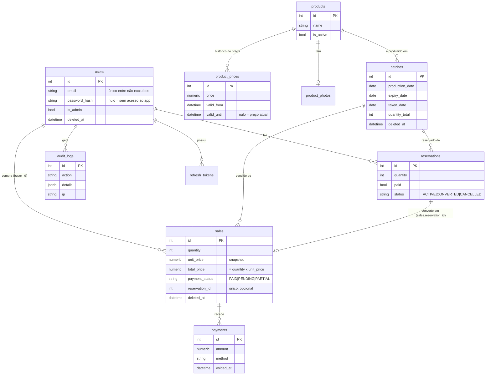

# Fase 1 – Arquitetura e banco de dados

## Estrutura de pastas

```
venda-doces/
├── backend/                  FastAPI + SQLAlchemy 2 + Alembic
│   ├── app/
│   │   ├── core/config.py    configurações (variáveis de ambiente)
│   │   ├── db/               Base declarativa e sessão (1 transação por requisição)
│   │   ├── models/           tabelas (1 arquivo por assunto)
│   │   ├── services/stock.py fórmula de estoque + bloqueio de lote
│   │   ├── routers/          (Fase 2) endpoints por perfil
│   │   └── schemas/          (Fase 2) Pydantic de entrada/saída separados por perfil
│   ├── alembic/versions/     migrações
│   └── tests/
├── mobile/                   (Fase 3) Expo + TypeScript; build web publicado na Vercel
├── docs/
└── docker-compose.yml        Postgres local
```

Implantação: API no **Render**, banco no **Aiven** (`?sslmode=require` na `DATABASE_URL`), app web na **Vercel**.

## Modelo de dados



Tabelas de apoio: `refresh_tokens`, `rate_limits`, `settings` (limites de 7 e 30 dias de atraso).

## Mudanças em relação ao modelo original (e por quê)

| Mudança | Justificativa |
|---|---|
| Nomes de tabelas/colunas em inglês | Padrão de qualidade pedido; a interface continua em português. |
| Removido `reservations.venda_id`; fica só `sales.reservation_id` (UNIQUE) | Os dois lados criariam uma dependência circular na hora de converter. Uma única FK única garante "1 reserva → no máximo 1 venda". |
| `quantidade_total` = produzida = levada | Confirmado por você; um único campo. |
| Pagamentos têm `voided_at`/`void_reason` | Erros se corrigem anulando, não apagando (nada financeiro é apagado). Pagamentos anulados não entram na soma. |
| `users.password_hash` pode ser nulo | Cliente sem acesso ao app ainda pode ter venda/fiado registrada pelo ADM. |
| `users.failed_login_count` / `locked_until`; tabela `rate_limits` | Bloqueio por tentativas e rate limit persistem sem Redis. |
| `refresh_tokens` (guarda só o hash, com `family_id`) | Rotação com detecção de reuso: reuso revoga a família inteira. |
| Fotos em `product_photos` (≤ 512 KB) | O disco do Render é efêmero e o Aiven não tem armazenamento de arquivos. |
| `CHECK (total_price = quantity * unit_price)` | Segunda barreira, no banco, além do cálculo no backend. |
| Índice único parcial em `product_prices` (um preço atual por produto) e em `users.email` (só não excluídos) | Impede dois preços vigentes e permite reaproveitar e-mail de usuário removido. |
| Enums como `VARCHAR + CHECK` | Migrações mais simples que tipos ENUM do Postgres. |
| `created_by` em reservas/vendas/pagamentos | Rastreia quem registrou cada ação (ADM ou o próprio comprador). |

## Fórmula de estoque

```
disponível = quantidade_total
           − Σ reservas com status ACTIVE
           − Σ vendas não canceladas   (TODAS, inclusive as vindas de reserva)
```

Ao converter, a reserva deixa de ser ACTIVE (sai do termo "reservado") na mesma transação em que a venda
aparece (entra no termo "vendido"). Assim cada unidade é contada exatamente uma vez, sem exceção para vendas
vindas de reserva. Cancelar reserva ou venda devolve a quantidade automaticamente.

## Estratégia de concorrência

1. Toda operação que pode reduzir o estoque (reservar, vender, converter, reduzir o tamanho do lote) começa com
   `SELECT ... FROM batches WHERE id = :id FOR UPDATE` (`stock.lock_batch`).
2. Com o lote travado, calcula-se o disponível e só então se insere. Requisições simultâneas **do mesmo lote**
   esperam na fila; lotes diferentes não se atrapalham.
3. Ordem de bloqueio fixa (lote → reserva/venda) para evitar deadlock. Pagamentos travam a linha da venda
   para que a soma nunca passe do total.
4. Tudo em uma transação por requisição (`get_session`): ou tudo, ou nada.

Prova: `tests/test_stock.py::test_concurrent_reservations_never_oversell` dispara 8 reservas simultâneas de 2
unidades num lote de 10 e exige exatamente 5 sucessos. Sem o bloqueio, o mesmo teste falha (7 sucessos = venda a mais).

## Premissas registradas

- Reservas não expiram; comprador ou ADM podem cancelar enquanto ACTIVE.
- Só o ADM marca uma reserva como paga.
- Sem preço de custo.
- **Criptografia de campo dispensada por você** (e-mail/telefone ficam legíveis no banco). Só a senha é protegida (Argon2id).
  Proteção compensatória: o Aiven criptografa discos e backups em repouso e a conexão exige TLS.
  *Risco aceito:* quem tiver acesso ao banco vê e-mail e telefone.
- Itens que você não detalhou seguem o padrão sugerido: pagamentos errados são **anulados** (não apagados),
  e na exclusão LGPD o usuário é **anonimizado** mantendo vendas e dívidas.
- A dívida nunca expira nem é arquivada: sempre aparece em "A Receber" até ser quitada.
- O comprador vê o valor de cada compra, mas nenhum total acumulado.

## Como rodar e testar

```bash
docker compose up -d db                # ou use um Postgres seu
cd backend
python3.12 -m venv .venv && .venv/bin/pip install -r requirements-dev.txt
cp .env.example .env                   # ajuste DATABASE_URL e JWT_SECRET
createdb venda_doces_test              # banco só para testes (ou defina TEST_DATABASE_URL)
.venv/bin/alembic upgrade head         # cria as tabelas
.venv/bin/pytest -q                    # 14 testes
```
